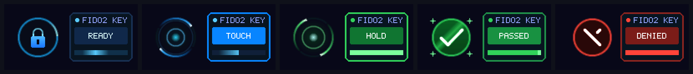
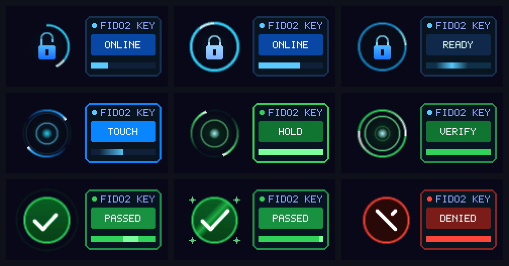
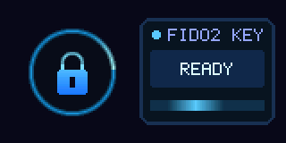
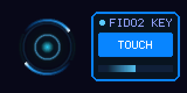
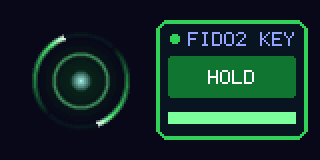
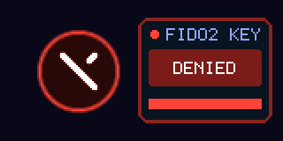

# 🗝️ MiniKey Forge (MSU2 MINI FIDO2)

> **用一枚微型国产 RISC-V 芯片与一块灵动彩屏，打造属于自己的现代化 Passkey 物理安全密钥。**

<p align="center">
  
</p>

<p align="center">
  
  
  
  
  
  
</p>

---

## 🌟 为什么要做 MiniKey Forge？

市面上常见的物理安全密钥（如 YubiKey 等）虽然成熟，但日常使用体验往往相当“冷酷”——大多数就是一个没有屏幕的纯色塑料块，全靠一颗幽暗的单色 LED 闪烁来猜测状态：
*当前是电脑发起了连接，还是在等待我触摸？刚才轻触到底有没有成功？是因为 PIN 码输错了被拒绝，还是网络超时了？*

**MiniKey Forge** 的初衷，就是想做一个**既足够硬核严谨、又富有生动人机交互**的便携 Passkey 物理硬件密钥。

我们在仅有手指大小的 **MSU2 MINI** 开发板（基于沁恒 **CH32X033** RISC-V 微控制器）上，点亮了一块 0.96 英寸的 ST7735S IPS 高清彩屏，并手写了一套抗锯齿微动效引擎。无论是开机时的挂锁自检、等待轻触时的声呐波纹，还是认证通过瞬间媲美 Apple Pay / Face ID 般的弹性打勾与粒子星光庆祝，让每一次身份认证都变得清晰、直观、富有仪式感！✨

---

## 🎨 灵动微动效与视觉交互

固件内置专为 160×80 屏幕打造的轻量级抗锯齿渲染流水线（硬件 SPI 12 MHz + 局部脏矩形更新），提供 **35+ FPS** 顺滑交互动效：

<p align="center">
  
</p>

### 核心状态速览

| 状态 | 屏幕画面 | 交互设计细节 |
| :--- | :---: | :--- |
| **就绪待机**<br>`READY` |  | 启动时锁扣自动入场闭合（Face ID 风格）并伴随冲击波光晕；待机时深邃星空底色伴有轻柔的呼吸光晕与环绕流星。 |
| **轻触提示**<br>`TOUCH` |  | 收到鉴权请求后，蓝白双流星高速环绕，屏幕荡漾出声呐涟漪（Sonar Waves），指引手指贴紧触摸铜箔极片。 |
| **触摸确认**<br>`HOLD` |  | 电容触摸感知毫秒级触发！徽章瞬时切换为翠绿 `HOLD` 状态，外圈涟漪内缩汇聚，给予实时的物理接触正反馈。 |
| **认证通过**<br>`PASSED` |  | Apple Pay / 绿圈弹入 + 双行程弹性阻尼勾选（Elastic Overshoot），随后绽放 4 颗庆祝星光与斜向高光掠过！ |
| **拒绝/超时**<br>`DENIED` |  | 认证失败或取消时，画面触发左右物理阻尼摆动（Horizontal Shake），红圈中渐进绘制出醒目的珊瑚红打叉 `×`。 |

---

## 🛡️ 硬核安全与协议特性

别看小屏幕灵动有趣，底层密码学与防掉电容灾设计同样一丝不苟：

- **现代 Passkey & 驻留凭据（Resident Credentials）**：
  - 完美支持 WebAuthn / FIDO2 / CTAP 2.0 及 **CTAP 2.1** 规范。
  - 支持免输用户名的发现式登录（Discoverable Credentials / 无 `allowList` 自动账号发现）。
  - 最大可保存 **48 个**活跃常驻凭据（支持多账号切换与同 RP/用户自动更新）。
- **ClientPIN 与用户在场（UP / UV）**：
  - 严格实现 CTAP2 协议 1 的 P-256 ECDH 密钥协商与 AES-256-CBC PIN 加密通道。
  - 支持 CTAP 2.1 子命令 9 发放的标准 32 字节 `pinUvAuthToken` 与权限范围管理。
  - 独立持久化 PIN 错误计数器（最多允许 8 次重试，连续输错 3 次锁定强制拔插），防止离线暴力破解。
- **A/B 双存储 Bank 防掉电容灾系统**：
  - 选用外部 SPI Flash 独立扇区，采用 **A/B 双 Bank 动态垃圾回收（GC）** 架构。
  - 每次签名采用追加写入，满载时原子迁移至备用 Bank，并以 HMAC-SHA256 头校验后原子切换。
  - 私钥与用户敏感数据全链路经由 **AES-256-CTR** 加密保护，即使遭遇异常拔掉电源也绝不丢号或损坏库结构。
- **生产特供版优化（Zero Overhead）**：
  - 正式生产固件默认彻底关闭运行时 Flash 调试写盘，**Flash 磨损为 0**，认证流程零 I/O 等待延迟。
  - 固件 App 净体积仅 **50.2 KiB**（预留 6 KiB 栈空间），运行轻巧稳健。

---

## 💻 平台兼容性

目前 MiniKey 已在多平台下经过严格的真实网站日常登录测试：

| 操作系统 / 浏览器 | 兼容表现 | 验证服务与场景 |
| :--- | :---: | :--- |
| **macOS (Safari / Chrome)** | 🟢 **100% 完美支持** | 针对 Safari / WebKit 的静默无交互探测（`allowList: []`）提供专有 `0x2E` 负反馈协商，Google、Apple、OpenAI、Tailscale Passkey 秒级免密登录。 |
| **Windows 11 (Hello / Edge / Chrome)** | 🟢 **100% 完美支持** | 原生兼容 Windows 11 安全密钥管理器、PIN 码管理、驻留密钥发现与快速验证。 |
| **Linux (Chromium / Firefox / pam-u2f)** | 🟢 **支持** | 标准 HID 接口即插即用，支持桌面浏览器 WebAuthn 登录与系统 PAM 认证。 |
| **Android 16 (Chrome / Play 凭据管理器)** | 🟡 *已知局限* | Google Play 服务（GmsCore）在收到 PIN token 约 10ms 后在本地主动发出了 `CANCEL`，暂无法完成手机端外部漫游密钥登录，作为已知 Issue 追踪中。 |

---

## 🚀 快速上手与本地把玩

本项目使用干净的 Python + 轻量工具链驱动，无需复杂的 IDE 安装，支持在本地电脑上完成仿真测试与一键烧录。

### 1. 环境准备 (Windows 11 / PowerShell 7)

```powershell
# 克隆仓库
git clone https://github.com/B416-JAFLY/minikey-forge.git
cd minikey-forge

# 创建专属虚拟环境并安装依赖
python -m venv .venv
.\.venv\Scripts\python.exe -m pip install -r requirements-lock.txt
.\.venv\Scripts\python.exe fetch-dependencies.py
.\.venv\Scripts\python.exe setup-tools.py
```

### 2. 运行宿主端单元测试（71 项全通）

利用自带的 Zig 编译器直接把固件逻辑编成 DLL，在本地 PC 跑完包括协议边界、掉电擦写模拟、乃至 **UI 逐像素点阵绘制** 的完整自动化测试：

```powershell
.\build.ps1 -HostTest
.\.venv\Scripts\python.exe -m pytest tests -q
# 输出: 71 passed in 3.73s
```

### 3. 编译与烧录固件

```powershell
# 1. 编译生产固件 (默认关闭耗电日志，极速稳健)
.\build.ps1

# 2. 烧录固件至物理板卡（安全烧录并自动验证硬件通信与账号留存）
.\.venv\Scripts\python.exe private/flash_and_backup.py flash-only
```
> 💡 烧录时终端会提示 `WAITING_TOUCH_FOR_ISP`，只需轻触一下板子上的触摸铜箔，即可自动进入 ISP 烧录并完成全部硬件自检！

### 4. 离线备份你的密钥资产

```powershell
# 离线备份物理密钥中的所有账号凭据（需触摸授权）
.\.venv\Scripts\python.exe private/flash_and_backup.py backup
```
导出的凭据备份将以加密文件形式安全保存在 `private/` 目录下（受 `.gitignore` 保护）。

---

## 🛠️ 硬件与物料选型

* **主控 MCU**：沁恒微电子 (WCH) [CH32X033F8P6](http://www.wch.cn) (RISC-V 32 位内核, 62 KiB Code Flash, 20 KiB SRAM)
* **显示屏**：0.96 英寸 ST7735S IPS 彩色 LCD 屏（160×80 分辨率，8-pin 硬件 SPI）
* **存储器**：板载 1 MiB SPI NOR Flash
* **触摸板**：MCU 内部电容式触摸通道（TouchKey）

---

## 🤝 致谢与生态开源

* [micro-ecc](https://github.com/kmackay/micro-ecc) - 轻量高效的 ECDSA P-256 密码学实现
* [tiny-aes](https://github.com/kokke/tiny-AES-c) - 适用于嵌入式的小型 AES 实现
* [wchisp](https://github.com/ch32-rs/wchisp) - 优雅强大的开源 WCH ISP 烧录工具
* [python-fido2](https://github.com/Yubico/python-fido2) - Yubico 官方的 FIDO2 协议栈与测试框架

欢迎安全爱好者与硬件极客 Star、Fork、提 Issue 或共同交流！让每个人都能拥有属于自己的灵动 Passkey。🎉
